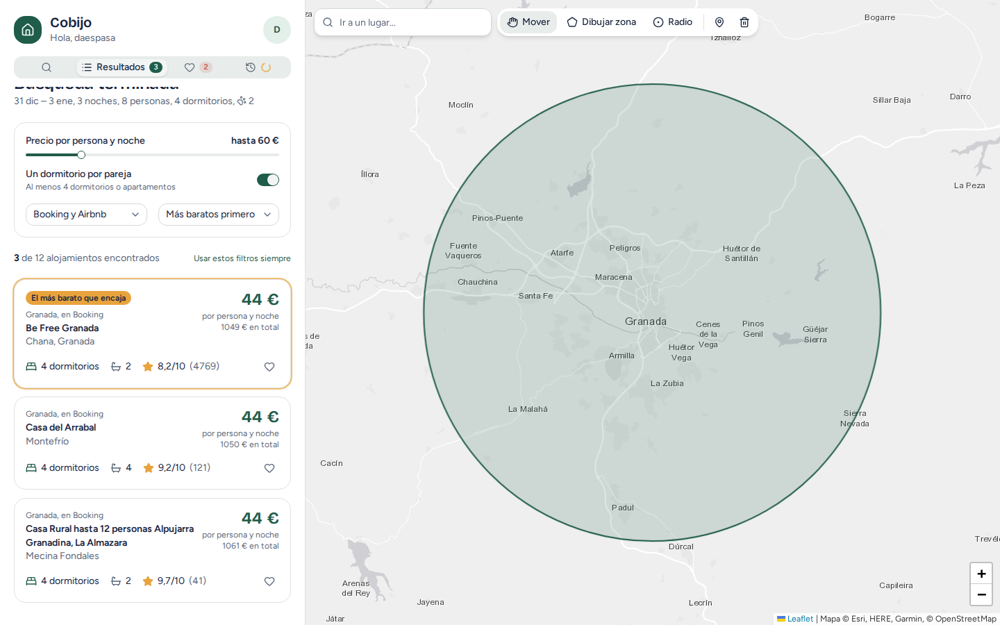
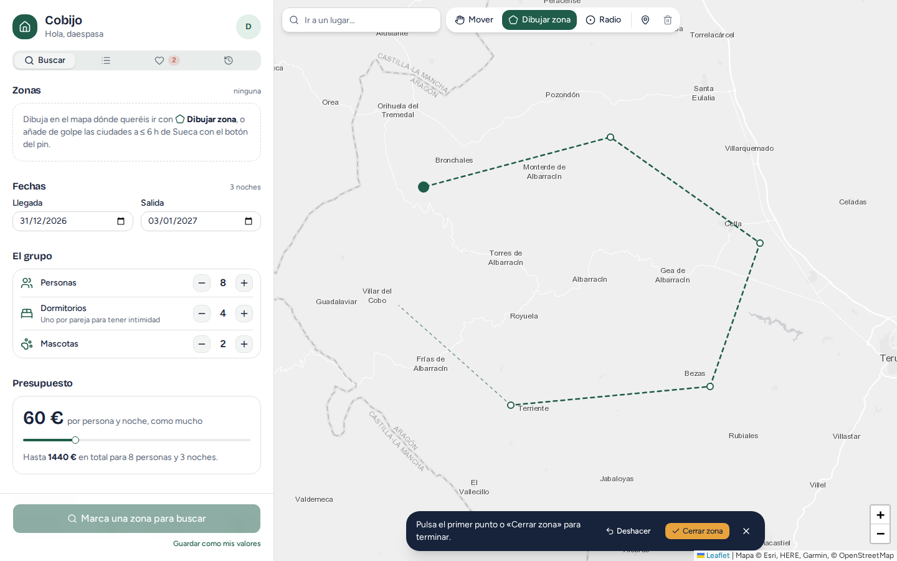

# Cobijo

[](https://github.com/daespasa/cobijo/actions/workflows/ci.yml)
[](LICENSE)


**Busca alojamiento para grupos en Booking y Airbnb dentro de la zona que dibujas en el mapa.**

Encontrar una casa para 8 personas, 4 parejas que quieren su habitación y 2 perros, en cualquier sitio a menos de 6 horas, dentro de un presupuesto por persona, obliga a abrir decenas de pestañas en dos webs que no filtran igual. Cobijo hace esa búsqueda por ti: marcas la zona, dices cuántos sois y cuánto queréis gastar, y te devuelve una lista comparable con el precio por persona y noche, el número de dormitorios y cada alojamiento en el mapa.



## Funcionalidades

- **Zonas en el mapa, en cualquier país**: dibuja un polígono punto a punto o marca un radio en km. Puedes combinar varias zonas en una búsqueda o añadir de golpe una lista de ciudades sugeridas. El mapa sale en español (Venecia, Londres, Múnich…).
- **Booking y Airbnb a la vez**, con los filtros de cada web: alojamiento entero, mascotas, dormitorios mínimos, cancelación gratis y comodidades (parking, piscina, chimenea…).
- **Resultados exactos**: se leen las coordenadas de cada anuncio y se descarta lo que cae fuera de tu zona. Cada resultado aparece en el mapa con su precio.
- **Pensado para grupos**: precio por persona y noche, total del viaje, aviso si no hay un dormitorio por pareja.
- **Bien situado**: distancia de cada alojamiento al centro de su ciudad o pueblo, nota de ubicación de Booking y filtro «a 1/3/10 km del centro o menos».
- **Para decidir**: nota de cada web (y nota mínima comparable entre las dos), «Recomendación del viajero» de Airbnb, alojamientos nuevos sin valoraciones y orden por precio, nota o lo céntrico que está.
- **Usuarios**: historial de búsquedas, listas de alojamientos guardados («Fin de año», «Las que votamos»…) y preferencias por persona (punto de salida, valores del formulario y filtros).
- **Ligero**: servidor Node sin framework (~50 MB en reposo). Chromium solo se abre mientras dura una búsqueda.



## Cómo funciona

```
 navegador (React + shadcn/ui + Leaflet + MapLibre)
        │  JSON · cookie de sesión
        ▼
 servidor  node:http ──► SQLite (better-sqlite3)
        │                 usuarios · sesiones · búsquedas · resultados · listas
        ▼
 cola de búsquedas ──► Playwright/Chromium ──► Booking · Airbnb
                        (una a la vez, sin descargar imágenes)
```

Cada zona se traduce a la búsqueda nativa de cada web: Booking por coordenadas y radio, Airbnb por un rectángulo. Después se leen las tarjetas de resultados y los datos internos de la página (coordenadas), se calcula el precio por persona y se recorta a la forma exacta de la zona.

## Puesta en marcha

Requisitos: **Node 20.11 o superior** y Linux, macOS o WSL.

```bash
git clone https://github.com/daespasa/cobijo.git
cd cobijo
npm install && npm install --prefix web
npx playwright install chromium
npm run build      # compila la web en public/
npm start          # http://127.0.0.1:8787
```

En el primer arranque, con la base de datos vacía, se crea el usuario `admin` (o el que indiques en `COBIJO_ADMIN`) y su contraseña sale en la consola. Para crear más:

```bash
npm run users -- add ana "Ana"     # muestra la contraseña una vez
```

En Linux puedes añadirlo al menú de aplicaciones con `npm run install:desktop`: el lanzador arranca el servidor si no está en marcha y abre el navegador.

## Uso

1. **Dibuja la zona**: pulsa *Dibujar zona*, haz clic en cada punto y cierra pulsando el primero (o *Intro*). *Retroceso* deshace y *Esc* cancela. Con *Radio* marcas un centro y unos km.
2. **Describe el grupo**: fechas, personas, dormitorios (uno por pareja), mascotas, precio máximo por persona y noche, webs y comodidades.
3. **Busca**: la búsqueda corre en segundo plano (unos 15–20 s por zona y web) y los resultados van apareciendo. Queda guardada en el historial.
4. **Compara y guarda**: filtra por precio, dormitorios o web, y guarda los que te gusten en una o varias listas con el corazón.

*Guardar como mis valores* (formulario) y *Usar estos filtros siempre* (resultados) hacen que la app empiece así cada vez que entras.

## Gestión de usuarios

```bash
npm run users -- list                    # usuarios y último acceso
npm run users -- add <usuario> [nombre]  # crear (contraseña generada)
npm run users -- passwd <usuario>        # nueva contraseña y cierra sus sesiones
npm run users -- remove <usuario>        # borrar con todo su historial
```

Cada usuario cambia su contraseña y sus preferencias desde la app. La sesión dura 30 días.

## Configuración

| Variable | Por defecto | Para qué |
|---|---|---|
| `PORT` | `8787` | Puerto del servidor |
| `HOST` | `127.0.0.1` | Interfaz. `0.0.0.0` lo abre a tu red local |
| `COOKIE_SECURE` | — | Pon `1` si lo sirves detrás de HTTPS |
| `COBIJO_DB` | `data/busquedas.sqlite` | Ruta de la base de datos |
| `COBIJO_ADMIN` | `admin` | Usuario que se crea en el primer arranque |

Las ciudades sugeridas, el punto de salida por defecto y los valores iniciales del formulario están en [`src/tripConfig.mjs`](src/tripConfig.mjs).

## Desarrollo

```bash
npm start          # API en :8787
npm run dev        # web con recarga en :5173 (redirige /api al servidor)
npm test           # parsers, URLs, geometría, coordenadas y login/sesiones de extremo a extremo
```

```
src/
  server.mjs            API HTTP, cola de búsquedas, validación y cabeceras de seguridad
  db.mjs                esquema SQLite, migraciones, contraseñas y sesiones
  searchScraper.mjs     URLs de Booking/Airbnb, lectura de tarjetas, coordenadas y geometría
  users.mjs             CLI de usuarios
  tripConfig.mjs        valores por defecto y ciudades sugeridas
  *.test.mjs            tests (node:test)
  scraper.mjs, index.mjs, restaurants.mjs …   scrapers originales de fichas y restaurantes (CLI)
web/src/
  App.tsx               sesión, estado y pestañas
  components/           mapa, formulario, resultados, listas, historial, menú de usuario
  components/ui/        componentes de shadcn/ui
scripts/                lanzador de escritorio para Linux
```

## Limitaciones

- Booking y Airbnb cambian su HTML a menudo. Si una zona sale vacía, Cobijo lo indica con un enlace para abrir esa búsqueda en la web y comprobarla.
- El radio de Booking es aproximado («y alrededores»); por eso se recorta con las coordenadas de cada anuncio.
- Los precios son los del momento de la búsqueda. Confirma siempre en la web antes de reservar, sobre todo el suplemento por mascotas.
- El centro de cada ciudad es el punto que marca OpenStreetMap (normalmente el casco histórico o el ayuntamiento). Se consulta una vez por municipio a Nominatim, respetando su límite de 1 petición por segundo, y se guarda en caché: la primera búsqueda en una zona nueva tarda unos segundos más.
- En Airbnb la cancelación gratis solo se conoce si la pides al buscar (sus tarjetas no lo indican).

## Aviso

Proyecto personal para uso privado y con moderación. Automatizar búsquedas puede ir en contra de las condiciones de uso de Booking y Airbnb: respeta sus términos y no lo uses para extraer datos de forma masiva ni con fines comerciales. Cobijo no está afiliado a ninguna de las dos.

Mapa de [OpenFreeMap](https://openfreemap.org) © [OpenMapTiles](https://www.openmaptiles.org) © [OpenStreetMap](https://www.openstreetmap.org/copyright), dibujado con [MapLibre](https://maplibre.org). Búsqueda de lugares y centros de ciudades con [Nominatim](https://nominatim.org).

## Licencia

[MIT](LICENSE) © daespasa
